# Direction artistique — « Studio 10 »

Culturisk se joue comme un grand quiz télé de culture générale, réinterprété pour l'iPhone :
un plateau de studio la nuit, des pupitres lumineux, un tableau de 10 thèmes qui s'allume
case après case. Rétro sans être vieillot, télévisuel sans copier aucune émission existante.

L'identité est **originale** : aucun logo, aucune typographie, aucun habillage ni jingle d'émission
existante n'est repris.

## Le concept

**Le tableau des 10 thèmes est le héros.** Chaque thème est une échelle lumineuse de 10 cases :
les cases réussies s'illuminent dans la couleur du thème, les questions perdues restent barrées,
la prochaine case pulse doucement. On voit en un coup d'œil où en est la partie, et ce qu'il reste à gagner.

Autour du tableau : deux pupitres d'équipe avec compteurs digitaux, un bandeau de manche,
une carte question claire comme un carton d'animateur.

## Palette

| Rôle | Valeur | Usage |
|---|---|---|
| Studio 0 | `#08081f` | Fond profond |
| Studio 1 | `#110f38` | Fond haut, barre d'état |
| Studio 2 | `#1b1952` | Panneaux |
| Projecteurs | violet `#7a4cff`, bleu `#2878ff`, orange `#ff783c` | Halos très doux en arrière-plan |
| Carte | `#fff8ec` sur encre `#17153d` | Questions et « Le saviez-vous ? » |
| Or | `#ffc94a` → `#ff9f1c` | Bouton principal (buzzer), titres, manche |
| Équipe 1 | ambre `#ffb547` | Pupitre gauche |
| Équipe 2 | lagon `#5ad7ff` | Pupitre droit |
| Succès / refus | `#34df8f` / `#ff6470` | Arbitrage uniquement |

### Couleurs des thèmes (stables toute la partie)

| Thème | Couleur | Pictogramme |
|---|---|---|
| Sport | rouge énergique `#ff4d4f` | coupe |
| Histoire | cuivre doré `#d9965b` | temple antique |
| Géographie | bleu azur `#3aa6ff` | globe |
| Sciences et nature | vert émeraude `#22c98a` | atome |
| Littérature | violet `#b06cff` | livre ouvert |
| Cinéma et séries | rose magenta `#ff4fa3` | clap |
| Musique | jaune lumineux `#ffd23f` | notes |
| Internet et culture web | cyan électrique `#2fe0f0` | curseur |
| Religions et mythologies | indigo `#6f7bff` | soleil rayonnant |
| Art et culture générale | orange chaleureux `#ff8a3d` | palette |
| Gastronomie | corail `#ff7a6b` | fourchette et couteau |
| Langue française | parchemin `#efd9a7` | plume |
| Animaux | ocre fauve `#e0b04a` | empreinte |
| BD et mangas | rose bonbon `#ff9ed2` | bulle |
| Jeux vidéo et de société | vert arcade `#c6f432` | dé |
| Inventions et techniques | acier `#9fb3c8` | ampoule |
| Télévision et médias | fuchsia néon `#e879f9` | poste de télévision |
| Marques et économie | vert-de-gris `#4fd1c5` | étiquette |

Les 10 premiers sont les thèmes « classiques » : sélection par défaut et segments du logo.
Les joueurs choisissent les thèmes de leur partie (3 au minimum, 18 au maximum) dans une grille
de pastilles aux couleurs des thèmes ; au-delà de 10 thèmes, le tableau compact passe sur deux rangées.

Chaque couleur a une « encre » sombre associée pour le texte posé dessus (contraste élevé).
Les couleurs servent aux lignes du tableau, aux échelles, aux capsules de thème, au bouton « Jouer »,
au liseré de la carte question, à l'éclair de bonne réponse et à la carte « Le saviez-vous ? ».

## Typographie

| Rôle | Police | Pourquoi |
|---|---|---|
| Titres, chiffres de points, libellés | **Unbounded** (500, 700, 900) | Géométrique, large, une touche rétro « générique télé » sans être une police de marque. |
| Questions et explications | **Figtree** (500, 600, 800) | Très lisible à distance, autour d'une table. |
| Scores | **DSEG7** | Compteur 7 segments avec segments « fantômes » (`88`) en arrière-plan, comme un tableau de studio. |

Toutes sous licence SIL OFL, auto-hébergées (aucun appel réseau).
La typographie française est respectée (espaces fines insécables avant « ? ! : ; » et dans les guillemets).

## Composants

- **Pupitres** : cartes sombres en relief ; celui qui a la main s'éclaire (liseré + halo de la couleur
  d'équipe) avec un **chenillard d'ampoules** et une étiquette « À vous » ou « Interception ».
- **Bandeau de manche** : capsule « Manche 2/5 · Tour : … ».
- **Lignes de thème** : pastille-pictogramme en relief, nom, échelle de 10 segments, valeur en points.
  Sélection : la ligne s'allume et grossit légèrement. Thème quitté : hachures + cadenas
  « Verrouillé ce tour » (temporaire, distinct d'un thème « Complet »).
- **Tableau compact** : 10 colonnes de 10 segments qui montent du niveau 1 au niveau 10 ;
  la colonne en jeu est encadrée, les colonnes verrouillées passent en cadenas.
- **Carte question** : crème, liseré de la couleur du thème, reflet de projecteur, texte 21–28 px.
- **Buzzer** (bouton principal) : dégradé or avec épaisseur, s'enfonce au toucher.
- **Carte « Le saviez-vous ? »** : plus calme que l'écran de question ; fond crème teinté de la couleur
  du thème, pictogramme, titre, rappel de la question, réponse encadrée, explication en 17 px,
  encart « Fait surprenant », source.

## Mouvement (court, jamais bloquant)

| Moment | Animation | Son |
|---|---|---|
| Sélection d'un thème | la ligne s'allume, la pastille rebondit | petit « ding » |
| Validation | points de suspense dans le buzzer (0,6 s) | roulement |
| Bonne réponse | éclair radial de la couleur du thème, « +40 » qui s'envole, compteur qui défile, case qui flashe sur le tableau | arpège majeur |
| Mauvaise réponse | voile gris discret, bandeau « Droit de réponse » qui glisse, étiquette « Interception » qui clignote | deux notes descendantes douces |
| Interception réussie | rayons tournants + éclair + bandeau rayé « ×2 » | glissando + accord |
| Fin de tour | lignes du bilan qui entrent une à une | carillon |
| Fin de partie | rayons de studio, confettis légers (2,5 s), compteurs finaux, étoile du vainqueur | courte fanfare |

Toutes les animations durent moins d'une seconde (sauf confettis et rayons d'ambiance).
« Animations réduites » (réglage ou préférence système) les supprime. La question suivante
ne démarre jamais seule : un bouton « Continuer » attend les joueurs.

Le son est **synthétisé** (Web Audio), facultatif, sans musique continue.
Vibrations : API Vibration, et sur iPhone (iOS 18+) le tapotement de l'interrupteur natif.

## Icône

Un **C** formé des 10 segments de thèmes (la grille de progression) autour d'un **buzzer doré**,
sur fond de studio avec rayons. Lisible à 29 px comme à 1024 px.

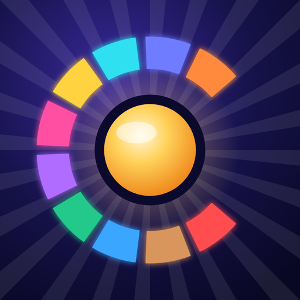

## Écrans

| Accueil | Choix du thème | Question |
|---|---|---|
| 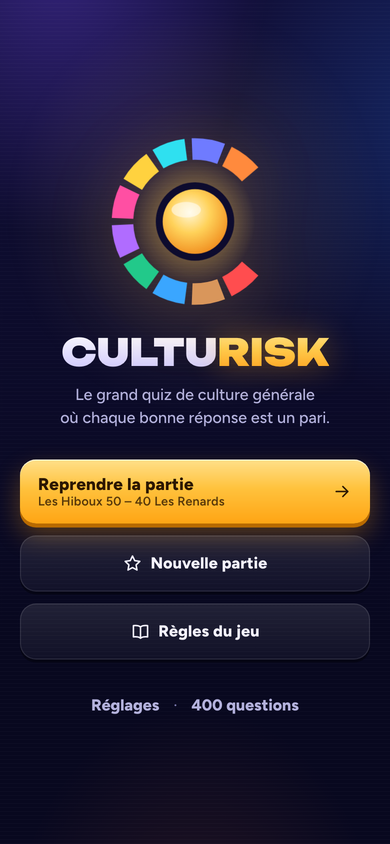 | 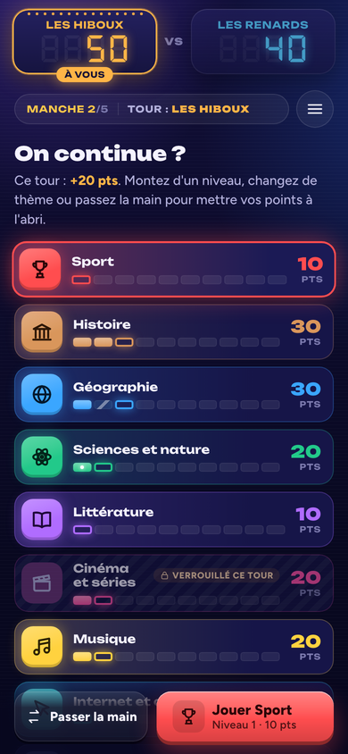 | 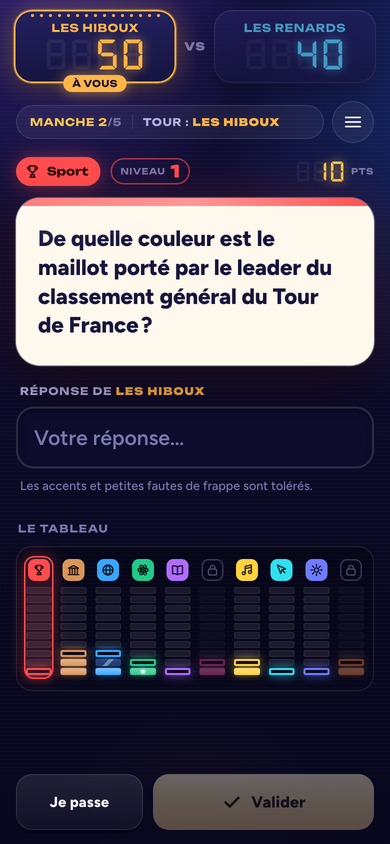 |

| Interception | Le saviez-vous ? | Arbitrage |
|---|---|---|
| 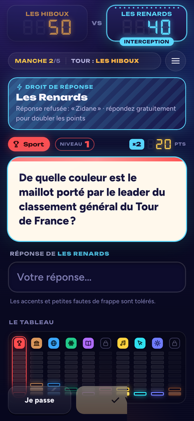 | 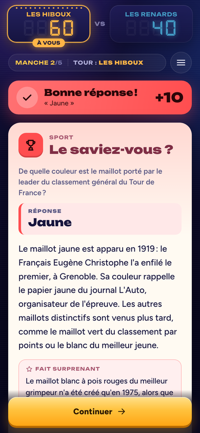 | 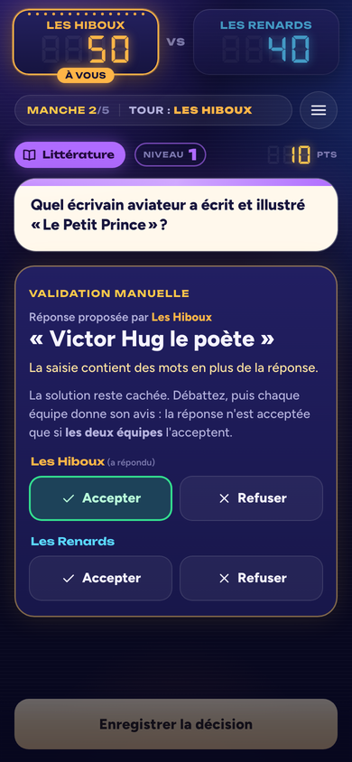 |

| Interception réussie | Fin de tour | Fin de partie |
|---|---|---|
| 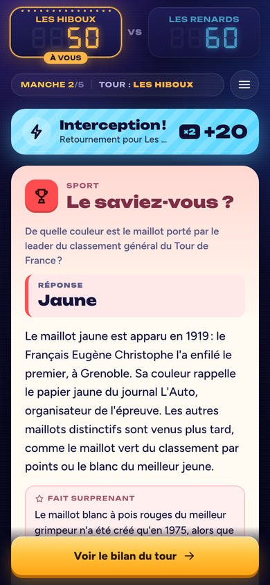 | 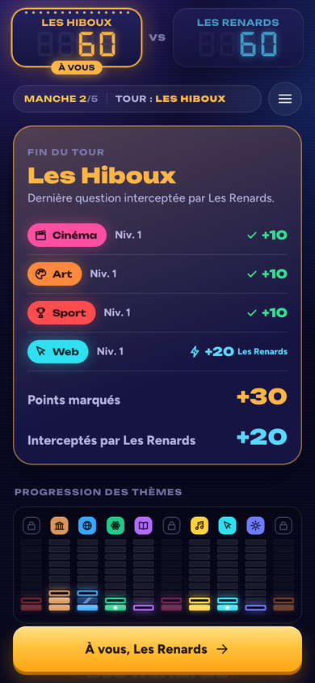 | 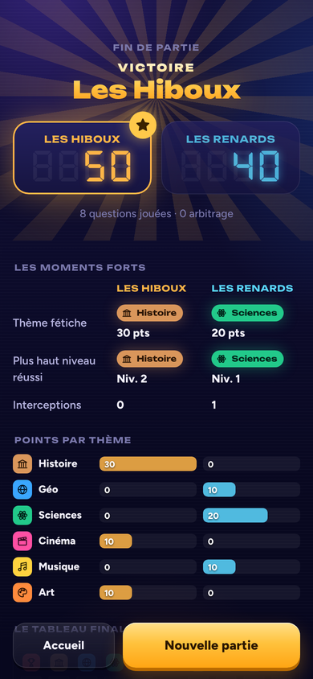 |

| Choix des thèmes | Partie à 18 thèmes |
|---|---|
| 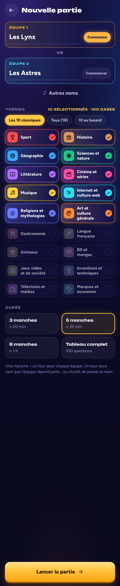 | 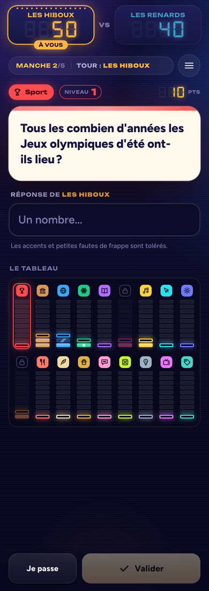 |
